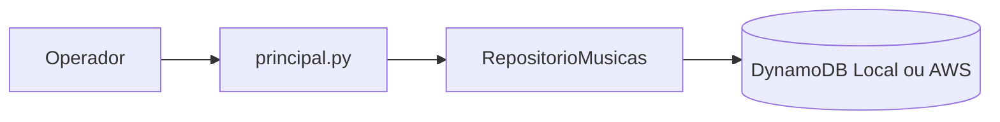

# Arquitetura

O adaptador recebe uma tabela compatível com boto3. Testes injetam uma implementação simulada, sem custo ou credencial de nuvem. Por padrão a CLI usa endpoint local; `--aws` altera explicitamente esse comportamento.
